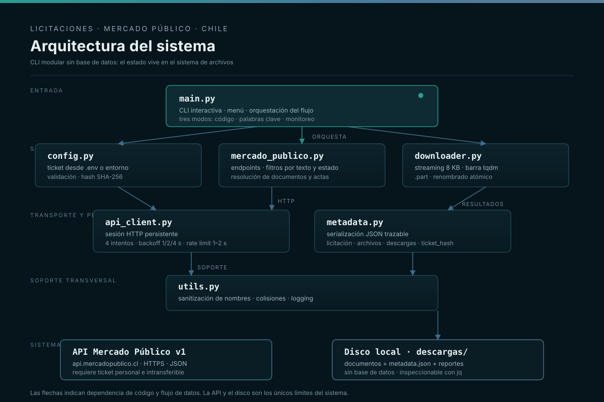

# Licitaciones Mercado Público — Buscador, Descargador y Monitor


Herramienta de línea de comandos para **buscar, descargar y monitorear licitaciones del Mercado Público de Chile** mediante la API oficial (`api.mercadopublico.cl`). Automatiza tres flujos que normalmente se hacen a mano en el portal: consulta por código, búsqueda por palabras clave y vigilancia periódica cada 30 minutos.

Todo lo descargado se organiza por código de licitación y se acompaña de un `metadata.json` con la respuesta completa de la API, el estado de cada archivo y la trazabilidad del proceso.

---

## Tabla de contenidos

- [1. El problema](#1-el-problema)
- [2. Qué hace este programa](#2-qué-hace-este-programa)
- [3. Los tres modos](#3-los-tres-modos)
  - [3.1 Búsqueda por código](#31-búsqueda-por-código)
  - [3.2 Búsqueda por palabras clave](#32-búsqueda-por-palabras-clave)
  - [3.3 Monitoreo cada 30 minutos](#33-monitoreo-cada-30-minutos)
  - [3.4 Comparativa](#34-comparativa)
- [4. Arquitectura](#4-arquitectura)
- [5. La API de Mercado Público](#5-la-api-de-mercado-público)
  - [5.1 Autenticación](#51-autenticación)
  - [5.2 Endpoints](#52-endpoints)
  - [5.3 Respuesta](#53-respuesta)
  - [5.4 Campos principales](#54-campos-principales)
  - [5.5 Estados](#55-estados)
  - [5.6 Tipos de licitación](#56-tipos-de-licitación)
  - [5.7 Límites de la API v1](#57-límites-de-la-api-v1)
- [6. Requisitos e instalación](#6-requisitos-e-instalación)
- [7. Configuración del ticket](#7-configuración-del-ticket)
- [8. Uso](#8-uso)
- [9. Ejemplos de uso](#9-ejemplos-de-uso)
- [10. Programación de ejecuciones](#10-programación-de-ejecuciones)
- [11. Estructura del proyecto](#11-estructura-del-proyecto)
- [12. Salida y metadata.json](#12-salida-y-metadatajson)
- [13. Funcionamiento interno](#13-funcionamiento-interno)
- [14. Límites y riesgos](#14-límites-y-riesgos)
- [15. Solución de problemas](#15-solución-de-problemas)
- [16. Seguridad](#16-seguridad)
- [17. Advertencias](#17-advertencias)
- [18. Documentación adicional](#18-documentación-adicional)
- [19. Contribuir](#19-contribuir)
- [20. Licencia](#20-licencia)

---

## 1. El problema

El Mercado Público chileno publica miles de procesos de compra al año. Revisarlos manualmente implica abrir ficha por ficha, comparar nombres y descripciones, descargar bases y anexos, y repetir el ciclo cada día. Los problemas concretos:

- **Volumen**: las oportunidades relevantes se pierden entre cientos de procesos de otras categorías.
- **Oportunidad**: una licitación puede pasar de Publicada a Cerrada en pocos días; enterarse tarde equivale a perderla.
- **Documentación dispersa**: bases, anexos y actas viven en enlaces distintos dentro de cada ficha.
- **Trabajo repetitivo**: descargar, renombrar y archivar PDFs es manual y propenso a errores.
- **Sin historial local**: el portal no está pensado para que un tercero acumule y compare oportunidades.

Este proyecto ataca esos puntos con una interfaz de terminal: consulta la API oficial, filtra localmente, descarga documentos y deja un registro estructurado. No usa navegador, no hace scraping del HTML y no guarda credenciales en claro. Es una herramienta de **vigilancia de oportunidades**, no de participación automática: la decisión de ofertar sigue siendo humana.

---

## 2. Qué hace este programa

| Capacidad | Detalle |
|---|---|
| Consulta individual | Metadatos completos de una licitación por su código externo |
| Búsqueda local | Filtra el listado reciente por coincidencia en nombre y descripción |
| Filtro por estado | Solo vigentes (`CodigoEstado == 5`) o todos los estados |
| Documentos | Resuelve el acta de adjudicación y el endpoint de archivos si existe |
| Descarga con progreso | Streaming en bloques de 8 KB con barra `tqdm` |
| Descarga atómica | Escribe `.part` y renombra al finalizar |
| Reintentos | Backoff exponencial y espera especial ante HTTP 429 |
| Control de tasa | Pausas de 1 a 2 segundos con jitter entre peticiones |
| Nombres seguros | Sanitización multiplataforma y resolución de colisiones |
| Metadatos | `metadata.json` con la API completa y el estado de cada descarga |
| Monitoreo | Ciclos de 30 minutos con memoria de códigos vistos |
| Privacidad | Solo se persiste un hash SHA-256 del ticket |

Lo que **no** hace: no firma documentos, no envía ofertas, no automatiza la participación, no evade autenticación y no accede a datos que la API no exponga con un ticket válido.

---

## 3. Los tres modos

Al ejecutar `python main.py` aparece el menú:

```
══════════════════════════════════════════════════════════
  MENÚ PRINCIPAL
══════════════════════════════════════════════════════════
  1. Buscar licitación por código
  2. Buscar licitaciones por palabras clave
  3. Modo monitoreo cada 30 min (terminos fijos)
  0. Salir
──────────────────────────────────────────────────────────
  Opción:
```

### 3.1 Búsqueda por código

Flujo directo cuando se conoce el código externo (por ejemplo `1234567-8-LP24`):

1. Pide el código y normaliza la entrada: quita espacios, convierte guiones tipográficos (`—`, `–`, `−`) en `-` y colapsa guiones repetidos.
2. Rechaza códigos con `/`, `\` o `..` para evitar rutas maliciosas.
3. Consulta `GET /licitaciones.json?codigo=...&ticket=...`.
4. Extrae `Listado[0]` y muestra código, nombre, organismo, estado, tipo, fechas, monto y descripción.
5. Pregunta si se descargan los documentos.
6. Consulta el acta de adjudicación (si existe) y `/licitaciones/{codigo}/Archivos.json`.
7. Descarga con barra de progreso, guarda `metadata.json` y resume el resultado.

```
────────────────────────────────────────────────────────────
  Código          : 1234567-8-LP24
  Nombre          : Construcción Centro Comunitario
  Organismo       : Municipalidad de Providencia
  Estado          : Publicada
  Tipo            : LP
  Publicación     : 2026-05-01T10:00:00
  Cierre          : 2026-06-30T15:00:00
  Monto estimado  : $ 150,000,000
────────────────────────────────────────────────────────────
```

Ventaja: es el camino más rápido ante un código conocido. Limitación: no sirve para descubrir oportunidades.

### 3.2 Búsqueda por palabras clave

La API v1 no ofrece búsqueda por texto, así que el programa descarga el listado reciente y **filtra localmente**:

1. Pide términos separados por comas (`telemetria, iot, monitoreo, sensores`).
2. Pregunta si se limita a vigentes o incluye todos los estados.
3. Obtiene `GET /licitaciones.json?ticket=...`.
4. Descarta lo que no tenga `CodigoEstado == 5` si se eligió "solo vigentes".
5. Compara cada término en minúsculas contra `Nombre` y `Descripcion`.
6. Muestra resultados numerados; al elegir uno, consulta el detalle y ofrece descargar.

```
  Términos (vacío = todas las vigentes): telemetria, iot, sensor
  ¿Solo licitaciones vigentes? [S/n]: s

  Se encontraron 3 licitación(es):
────────────────────────────────────────────────────────────
    1. [1234-5-LP26] Adquisición de sensores de temperatura y humedad
    2. [5678-9-LQ26] Sistema de monitoreo IoT para cuencas hídricas
    3. [9012-3-LP26] Plataforma de telemetría para redes de riego
────────────────────────────────────────────────────────────
  Selecciona una licitación (1-3): 2
```

Buenos términos son sustantivos genéricos (`sensor`, `medicion`, `red`), tecnología (`iot`, `telemetria`, `software`), dominio (`riego`, `agua`, `energia`) o acciones (`monitoreo`, `reporte`, `alerta`). Las siglas raras reducen demasiado el universo. Como el listado puede no incluir la descripción completa, conviene usar términos amplios y revisar los resultados.

### 3.3 Monitoreo cada 30 minutos

Vigilancia continua pensada para dejarla corriendo en una terminal, `tmux`/`screen` o un servicio.

Términos fijos por defecto:

```
telemetria, monitor, monitoreo, medicion, sensores, riego, software,
alerta, reporte, iot, domotica, notificacion, temperatura, humedad,
presion, frio
```

Ciclo:

1. Consulta el listado y filtra por términos y estado.
2. Compara los códigos contra `descargas/monitoreo_vistos.json`.
3. Para cada código nuevo obtiene el detalle (pausas de 1 a 1,5 s).
4. Muestra código, nombre, descripción, cierre, estado y monto.
5. Escribe `descargas/monitoreo/YYYYMMDD_HHMMSS.txt`.
6. Actualiza el registro de vistos y espera 30 minutos. `Ctrl+C` detiene limpiamente.

```
[11:00:25] Ciclo 1 consultando API...
[11:00:25] Sin novedades.
[12:00:25] Ciclo 3 consultando API...
[12:00:25] NUEVAS LICITACIONES ENCONTRADAS:

  Codigo     : 1234-56-LP26
  Nombre     : Sistema de Telemetría para redes hídricas
  Descripcion: Implementación de plataforma IoT con sensores...
  Cierre     : 2026-07-25T15:00:00
  Estado     : 5
  Monto      : $ 45,000,000

  Reporte guardado: descargas/monitoreo/20260701_120025.txt
```

La memoria de vistos es un `set` persistido como JSON: crece un código por licitación vista. Si se borra el archivo, el siguiente ciclo considera nuevas a todas las coincidencias actuales. El monitoreo **no es tiempo real**: la API entrega un listado reciente, no eventos; una licitación puede aparecer y desaparecer entre ciclos.

### 3.4 Comparativa

| Criterio | Código | Palabras clave | Monitoreo |
|---|---|---|---|
| Requiere código | Sí | No | No |
| Descubre oportunidades | No | Sí | Sí |
| Intervención humana | Alta | Media | Baja |
| Duración | Segundos | Segundos | Indefinida |
| Descarga documentos | Sí | Sí | No (solo reporta) |
| Persistencia | `metadata.json` | `metadata.json` | Reportes y registro |
| Uso típico | Consulta puntual | Exploración | Vigilancia |

---

## 4. Arquitectura

### 4.1 Vista general



Aplicación de consola monolítica con módulos de responsabilidad única. Sin base de datos, servidor web ni cola de tareas: el estado vive en `descargas/`.

```
             ┌──────────────────────────────┐
             │          main.py             │
             │  menú, flujo, presentación   │
             └──────────────┬───────────────┘
                            │
        ┌───────────────────┼───────────────────┐
        │                   │                   │
 ┌──────▼──────┐   ┌────────▼────────┐  ┌───────▼────────┐
 │  config.py  │   │ mercado_publico │  │  downloader.py │
 │   ticket    │   │  endpoints y    │  │ streaming tqdm │
 └─────────────┘   │  filtros        │  └───────┬────────┘
                   └────────┬────────┘          │
                            │                   │
                   ┌────────▼────────┐  ┌───────▼────────┐
                   │  api_client.py  │  │   metadata.py  │
                   │ retry + límite  │  │   JSON + hash  │
                   └────────┬────────┘  └───────┬────────┘
                            │                   │
                   ┌────────▼───────────────────▼────────┐
                   │              utils.py               │
                   │  sanitización, logging, colisiones  │
                   └─────────────────┬───────────────────┘
                                     │
                          ┌──────────▼───────────┐
                          │  API Mercado Público │
                          │   + disco local      │
                          └──────────────────────┘
```

### 4.2 Responsabilidad de cada módulo

| Módulo | Responsabilidad | Depende de |
|---|---|---|
| `main.py` | Interfaz, menú, orquestación, formato de salida | todos |
| `config.py` | Cargar y validar el ticket, generar hash | `python-dotenv` |
| `api_client.py` | Sesión HTTP, reintentos, backoff, rate limiting, JSON | `requests` |
| `mercado_publico.py` | Endpoints, filtros, resolución de documentos | `api_client` |
| `downloader.py` | Streaming, `.part`, colisiones, barra de progreso | `requests`, `tqdm` |
| `metadata.py` | Serialización de licitación, archivos y resultados | `config`, `downloader` |
| `utils.py` | Sanitización, logging, colisiones | biblioteca estándar |

La dependencia es unidireccional: `main` conoce a todos; la infraestructura no conoce a `main`. Eso permite reutilizar la API y la descarga desde scripts propios sin arrastrar la interfaz.

### 4.3 Flujo de una consulta

```
1. load_ticket()            → .env u os.environ (prioridad)
2. APIClient(timeout=30, max_retries=4)
3. fetch_licitacion()       → GET /licitaciones.json?codigo=...&ticket=...
                              detecta JSON de error y extrae Listado[0]
4. display_licitacion_summary()
5. fetch_archivos()         → Adjudicacion.UrlActa + /Archivos.json
6. download_all_files()     → sanitiza, resuelve colisión, streaming .part,
                              renombra atómicamente
7. save_metadata()          → licitación + archivos + descargas + sha256(ticket)
```

### 4.4 Decisiones de diseño

- **Sin framework CLI**: `input()` y `print()`; menos dependencias y una experiencia legible en cualquier terminal.
- **Sin base de datos**: JSON y texto plano, inspeccionables con `cat`, `jq` o un editor.
- **Sin scraping HTML**: solo API oficial; si un documento no está, se informa y se sugiere la ficha web.
- **Tolerancia a errores**: un archivo fallido no aborta la licitación; una licitación fallida no aborta el monitoreo.
- **Seguridad por defecto**: ticket enmascarado en logs y hasheado en metadatos.

---

## 5. La API de Mercado Público

### 5.1 Autenticación

Toda petición requiere un **ticket** personal enviado como query string:

```
https://api.mercadopublico.cl/servicios/v1/publico/licitaciones.json?ticket=TU_TICKET
```

Se obtiene gratis en <https://api.mercadopublico.cl/documentacion/obtencion-de-ticket>. Es personal e intransferible. El programa lo carga desde `MERCADO_PUBLICO_TICKET` o desde `.env`, en ese orden.

### 5.2 Endpoints

URL base: `https://api.mercadopublico.cl/servicios/v1/publico`

| Uso | Endpoint | Parámetros | Observación |
|---|---|---|---|
| Detalle por código | `/licitaciones.json` | `codigo`, `ticket` | Devuelve `Listado[0]` |
| Listado general | `/licitaciones.json` | `ticket` | Base de la búsqueda local |
| Documentos | `/licitaciones/{codigo}/Archivos.json` | `ticket` | Puede no existir (404 tolerado) |
| Acta | `Adjudicacion.UrlActa` | según URL | Solo si está adjudicada |

La v1 también ofrece `.xml`, `.jsonp` y parámetros como `fecha=DDMMAAAA` y `estado=...` según su documentación. **Esta implementación usa solo JSON y los parámetros indicados**; las variantes quedan como vía de extensión.

### 5.3 Respuesta

Las respuestas exitosas vienen envueltas:

```json
{
  "Cantidad": 1,
  "FechaCreacion": "2026-06-26T12:00:00",
  "Version": "v1",
  "Listado": [
    {
      "CodigoExterno": "1234567-8-LP24",
      "Nombre": "Construcción Centro Comunitario",
      "CodigoEstado": 5,
      "Estado": "Publicada",
      "Descripcion": "Construcción de centro comunitario...",
      "Comprador": {
        "NombreOrganismo": "Municipalidad de Providencia",
        "RutUnidad": "69.123.456-7"
      },
      "Fechas": {
        "FechaPublicacion": "2026-05-01T10:00:00",
        "FechaCierre": "2026-06-30T15:00:00"
      },
      "MontoEstimado": 150000000,
      "Moneda": "CLP",
      "Adjudicacion": { "UrlActa": "https://www.mercadopublico.cl/..." }
    }
  ]
}
```

Los errores también pueden llegar con HTTP 200/203 y cuerpo `{"Codigo": 203, "Mensaje": "Ticket no válido."}`. Por eso el programa **inspecciona el JSON además del código HTTP**: un `200 OK` no garantiza una respuesta útil.

### 5.4 Campos principales

La documentación oficial (incluida como PDF en el repositorio) define más de 90 campos. Los que se consumen o muestran:

| Campo | Tipo | Uso |
|---|---|---|
| `CodigoExterno` | texto (100) | Identificador y carpeta |
| `Nombre` | texto (255) | Resumen y filtro |
| `Descripcion` | texto | Resumen y filtro |
| `CodigoEstado` | entero | Filtro de vigentes (`5`) |
| `Estado` | texto | Texto mostrado |
| `Comprador.NombreOrganismo` | texto | Organismo |
| `Fechas.FechaPublicacion` | datetime | Resumen |
| `Fechas.FechaCierre` | datetime | Resumen y reporte |
| `MontoEstimado` | float | Monto en CLP |
| `Moneda` | texto | Contexto del monto |
| `Tipo` | texto | Tipo de licitación |
| `Adjudicacion.UrlActa` | texto | Documento adicional |
| `Items.Listado[]` | lista | Disponible en metadatos |

El programa tolera variantes de mayúsculas (`CodigoExterno`/`codigoExterno`) y campos anidados, porque la API no siempre es consistente entre endpoints.

### 5.5 Estados

| Código | Estado | ¿Vigente? |
|---|---|---|
| 1 | Publicada | No |
| 2 | Cerrada | No |
| 3 | Desierta | No |
| 4 | Adjudicada | No |
| 5 | Publicada | **Sí** |
| 6 | Cerrada | No |
| 7 | Desierta | No |
| 8 | Adjudicada | No |
| 9 | Revocada | No |
| 10 | Suspendida | No |
| 11 | Publicada | No |
| 15 | Suspendida | No |

El modo "solo vigentes" usa estrictamente `CodigoEstado == 5`. Si la API publica procesos vigentes con códigos 1 u 11, el filtro los excluirá. Es una decisión conservadora y documentada; para ampliarla, ver `docs/developer.md`.

### 5.6 Tipos de licitación

| Código | Significado |
|---|---|
| `L1` | Pública menor a 100 UTM |
| `LE` | Pública entre 100 y 1.000 UTM |
| `LP` | Pública entre 1.000 y 2.000 UTM |
| `LQ` | Pública entre 2.000 y 5.000 UTM |
| `LR` | Pública de 5.000 UTM o más |
| `LS` | Pública de servicios personales especializados |
| `E2` | Privada menor a 100 UTM |
| `CO` | Privada entre 100 y 1.000 UTM |
| `B2` | Privada entre 1.000 y 2.000 UTM |
| `H2` | Privada entre 2.000 y 5.000 UTM |
| `I2` | Privada de más de 5.000 UTM |

El sufijo del código externo (`-LP24`) suele coincidir con tipo y año, pero **no debe asumirse**: el identificador se trata como texto opaco.

### 5.7 Límites de la API v1

1. **Ventana corta**: el listado general expone solo las licitaciones más recientes (del orden de 188 a 200 según observación). No hay paginación histórica.
2. **Sin búsqueda por texto**: no existe `q=` ni equivalente; el filtro es local.
3. **Descripciones incompletas**: algunos ítems del listado traen `Descripcion` vacía o truncada.
4. **Documentos no siempre disponibles**: `Archivos.json` no existe para todos los procesos.
5. **Estados numéricos**: el listado puede no traer el texto de estado.
6. **Sin cuota publicada**: el programa aplica pausas de 1 a 2 s y respeta `429` con 5 s de espera.
7. **Disponibilidad variable**: puede responder lento o con 5xx en horas de demanda.
8. **Dependencia externa**: un cambio de contrato puede exigir adaptar el cliente; la versión está fijada en `/v1/`.

Si se necesita más historia, la v1 no lo resuelve: hay que acumular localmente (lo que hace este proyecto), usar datos abiertos de ChileCompra o revisar si existen endpoints nuevos.

---

## 6. Requisitos e instalación

Requisitos: **Python 3.9+** (probado en 3.14), conexión HTTPS, ticket válido y espacio en disco.

Las dependencias están en `requirements.txt`:

```text
requests>=2.28.0
python-dotenv>=1.0.0
tqdm>=4.65.0
```

Instalación con entorno virtual:

```bash
python3 -m venv venv
source venv/bin/activate        # Linux / Mac
venv\Scripts\activate           # Windows
pip install -r requirements.txt
```

Verificación:

```bash
python -c "import requests, dotenv, tqdm; print('dependencias OK')"
```

Instalar con `--user` es posible pero contamina el Python del sistema; para uso serio, usar `venv`. Para actualizar: `pip install --upgrade -r requirements.txt`.

---

## 7. Configuración del ticket

Orden de resolución:

1. Variable de entorno `MERCADO_PUBLICO_TICKET`.
2. Archivo `.env` en el directorio de trabajo (vía `python-dotenv`).
3. Si no existe: error explicativo y salida con código 1.

`python-dotenv` no sobrescribe variables ya definidas, por lo que la variable de entorno siempre gana.

**Opción A — `.env`:**

```bash
cp .env.example .env
```

```dotenv
MERCADO_PUBLICO_TICKET=TU_TICKET_AQUI
```

`.env` está en `.gitignore`. Nunca lo subas a un repositorio ni lo compartas.

**Opción B — variable de entorno:**

```bash
export MERCADO_PUBLICO_TICKET="TU_TICKET_AQUI"     # Linux / macOS
set MERCADO_PUBLICO_TICKET=TU_TICKET_AQUI          # Windows CMD
$env:MERCADO_PUBLICO_TICKET="TU_TICKET_AQUI"       # PowerShell
```

El programa elimina espacios y comillas, distingue "no definido" de "vacío" y no valida contra la API al inicio: el primer error de autenticación aparece al consultar.

---

## 8. Uso

```bash
python main.py
```

1. Se muestra el banner y el menú.
2. Se elige `1`, `2`, `3` o `0`.
3. Se sigue el flujo interactivo y se vuelve al menú.
4. `0`, `salir`, `exit` o `q` cierran el programa.

Comportamiento:

- `Ctrl+C` interrumpe la operación actual; en el menú, cierra.
- En preguntas sí/no, `Enter` acepta el valor por defecto (`[S/n]` o `[s/N]`).
- En el modo 2, `Enter` sin términos lista todas las vigentes; `0` vuelve al menú.
- En el modo 1, un código inválido consume uno de los 3 intentos.

Se escribe `descargas/downloader.log` en nivel `DEBUG` (consola en `INFO`). El log no contiene el ticket: el cliente enmascara el parámetro `ticket` como `***`.

---

## 9. Ejemplos de uso

### 9.1 Sesión completa por código

```
$ python main.py
  Opción: 1
Código de licitación: 1234567-8-LP24

Buscando licitación: 1234567-8-LP24 ...
──────────────────────────────────────────────────────────
  Código          : 1234567-8-LP24
  Nombre          : Construcción Centro Comunitario
  Organismo       : Municipalidad de Providencia
  Estado          : Publicada
  Monto estimado  : $ 150,000,000
──────────────────────────────────────────────────────────

¿Descargar documentos? [S/n]: s

Se encontraron 3 documento(s):
    1. Bases Administrativas.pdf  [pdf]
    2. Bases Tecnicas.pdf  [pdf] (1250000 bytes)
    3. Anexo N1 - Planos.zip  [zip]

Bases Administrativas.pdf: 100%|██████| 1.25M/1.25M [00:02<00:00, 512kB/s]
Bases Tecnicas.pdf: 100%|██████| 890k/890k [00:01<00:00, 445kB/s]
Anexo N1 - Planos.zip: 100%|██████| 4.50M/4.50M [00:08<00:00, 562kB/s]

──────────────────────────────────────────────────────────
  Archivos procesados : 3
  Descargados         : 3
  Saltados (existentes): 0
  Fallidos            : 0
──────────────────────────────────────────────────────────
  Ruta: /home/usuario/licitaciones/descargas/1234567-8-LP24/
```

### 9.2 Búsqueda de oportunidades de telemetría

```
Opción: 2
Términos: telemetria, iot, monitoreo, sensores, medicion
¿Solo licitaciones vigentes? [S/n]: s

  Se encontraron 5 licitación(es):
──────────────────────────────────────────────────────────
    1. [1234-5-LP26] Adquisición de sensores de temperatura y humedad
    2. [5678-9-LQ26] Sistema de monitoreo IoT para cuencas hídricas
    3. [9012-3-LP26] Plataforma de telemetría para redes de riego
    4. [3456-7-LE26] Servicio de medición remota de consumo eléctrico
    5. [7890-1-LS26] Monitoreo de variables ambientales en bodegas
──────────────────────────────────────────────────────────
  Selecciona una licitación (1-5): 3
```

### 9.3 Uso programático desde Python

La capa de API y descarga se reutiliza sin pasar por el menú:

```python
"""Consulta una licitación y lista sus documentos sin interfaz interactiva."""
from config import load_ticket
from api_client import APIClient, APIError
from mercado_publico import BASE_URL, fetch_licitacion, fetch_archivos

ticket = load_ticket()
client = APIClient(base_url=BASE_URL, timeout=30, max_retries=4)

try:
    data = fetch_licitacion(client, "1234567-8-LP24", ticket)
    print("Nombre:", data.get("Nombre"))
    print("Organismo:", data.get("Comprador", {}).get("NombreOrganismo"))
    print("Cierre:", data.get("Fechas", {}).get("FechaCierre"))

    archivos = fetch_archivos(client, "1234567-8-LP24", ticket, data)
    for a in archivos:
        print("-", a.get("Nombre"), "→", a.get("URL"))
except APIError as exc:
    print("Error de API:", exc)
finally:
    client.close()
```

### 9.4 Exportar coincidencias a CSV

Script independiente que usa el proyecto como biblioteca, sin modificar el código original:

```python
"""Exporta a CSV las licitaciones vigentes que coinciden con una lista de términos."""
import csv
from config import load_ticket
from api_client import APIClient
from mercado_publico import BASE_URL, buscar_licitaciones

TERMINOS = ["telemetria", "iot", "sensores", "monitoreo", "riego"]

ticket = load_ticket()
client = APIClient(base_url=BASE_URL)
try:
    resultados = buscar_licitaciones(client, ticket, terminos=TERMINOS, solo_vigentes=True)
    with open("oportunidades.csv", "w", newline="", encoding="utf-8") as fh:
        writer = csv.writer(fh)
        writer.writerow(["codigo", "nombre", "estado", "cierre", "organismo"])
        for r in resultados:
            writer.writerow([
                r.get("CodigoExterno", ""),
                r.get("Nombre", ""),
                r.get("CodigoEstado", ""),
                r.get("Fechas", {}).get("FechaCierre", ""),
                r.get("Comprador", {}).get("NombreOrganismo", ""),
            ])
    print(f"{len(resultados)} oportunidades exportadas")
finally:
    client.close()
```

```bash
python exportar_oportunidades.py
head -5 oportunidades.csv
```

**Precaución:** multiplicar peticiones y descargas puede acercarse a los límites no publicados de la API. Mantener los términos acotados y no ejecutar en paralelo con el monitoreo.

---

## 10. Programación de ejecuciones

El modo 3 incluye su propio bucle cada 30 minutos. Si se prefiere un proceso por ciclo (más robusto ante reinicios), se puede programar con el sistema operativo. **Advertencia:** `main.py` es interactivo; sin TTY el menú queda esperando y termina por EOF. Para automatizar de verdad hace falta un envoltorio no interactivo.

### 10.1 Cron (Linux / macOS)

```cron
*/30 * * * * cd /home/usuario/licitaciones && venv/bin/python ciclo_monitoreo.py >> cron.log 2>&1
```

### 10.2 Systemd (Linux)

```ini
# ~/.config/systemd/user/licitaciones-monitor.service
[Unit]
Description=Monitor de licitaciones Mercado Publico
After=network-online.target

[Service]
Type=simple
WorkingDirectory=%h/licitaciones
EnvironmentFile=%h/licitaciones/.env
ExecStart=%h/licitaciones/venv/bin/python %h/licitaciones/ciclo_monitoreo.py
Restart=on-failure
RestartSec=60

[Install]
WantedBy=default.target
```

```bash
systemctl --user daemon-reload
systemctl --user enable --now licitaciones-monitor.service
journalctl --user -u licitaciones-monitor.service -f
```

### 10.3 Windows

Programador de tareas → "Crear tarea básica" → desencadenador diario con repetición cada 30 minutos → acción `C:\ruta\venv\Scripts\python.exe` con argumento `ciclo_monitoreo.py` → iniciar en `C:\ruta\proyecto`.

### 10.4 Envoltorio no interactivo

```python
#!/usr/bin/env python3
"""Un ciclo de monitoreo para cron/systemd. Sin entrada interactiva."""
import json
from datetime import datetime
from pathlib import Path

from config import load_ticket
from api_client import APIClient
from mercado_publico import BASE_URL, buscar_licitaciones

TERMINOS = ["telemetria", "iot", "monitoreo", "sensores", "riego"]
VISTOS = Path("descargas/monitoreo_vistos.json")
SALIDA = Path("descargas/monitoreo")
SALIDA.mkdir(parents=True, exist_ok=True)

ticket = load_ticket()
client = APIClient(base_url=BASE_URL)
try:
    vistos = set(json.loads(VISTOS.read_text()).get("vistos", [])) if VISTOS.exists() else set()
    resultados = buscar_licitaciones(client, ticket, terminos=TERMINOS, solo_vigentes=True)
    nuevas = [r for r in resultados if r.get("CodigoExterno") not in vistos]

    if nuevas:
        sello = datetime.now().strftime("%Y%m%d_%H%M%S")
        lineas = [f"Reporte {datetime.now().isoformat()}", f"Nuevas: {len(nuevas)}", ""]
        for r in nuevas:
            codigo = r.get("CodigoExterno", "?")
            lineas += [f"Codigo: {codigo}", f"Nombre: {r.get('Nombre', '')}",
                       f"Cierre: {r.get('Fechas', {}).get('FechaCierre', '')}", "-" * 60]
            vistos.add(codigo)
        (SALIDA / f"{sello}.txt").write_text("\n".join(lineas), encoding="utf-8")

    VISTOS.write_text(json.dumps({"vistos": sorted(vistos)}, indent=2), encoding="utf-8")
    print(f"Ciclo completado: {len(nuevas)} nuevas")
finally:
    client.close()
```

### 10.5 Buenas prácticas

- No ejecutar dos instancias con el mismo ticket a la vez.
- Dejar ciclos de 30 minutos o más; la API cambia lento.
- Rotar o limpiar reportes antiguos de `descargas/monitoreo/`.
- Respaldar `monitoreo_vistos.json` si se conserva la memoria entre equipos.
- En servidores, preferir `systemd` con `Restart=on-failure` antes que `nohup`.
- Registrar hora y resultado de cada ciclo en un log propio.

---

## 11. Estructura del proyecto

```
licitaciones-mercado-publico/
├── main.py                     Punto de entrada y menú interactivo
├── config.py                   Ticket y hash SHA-256
├── api_client.py               Sesión HTTP, retry, rate limit
├── mercado_publico.py          Endpoints, filtros y documentos
├── downloader.py               Descarga streaming con tqdm
├── metadata.py                 Serialización de metadata.json
├── utils.py                    Sanitización, colisiones y logging
├── requirements.txt            requests, python-dotenv, tqdm
├── .env.example                Plantilla de configuración
├── .gitignore                  Excluye .env, descargas y logs
├── LICENSE                     MIT (2026 jmadasme)
├── README.md                   Este documento
├── Documentacion-API-Mercado-Publico-Licitaciones.pdf
├── docs/
│   ├── datasheet.md            Manual de usuario
│   ├── developer.md            Guía técnica
│   ├── REFERENCES.md           Fuentes y glosario
│   ├── BITACORA.md             Decisiones y lecciones
│   └── assets/                 Diagramas SVG
└── descargas/                  Generado en ejecución (ignorado por Git)
    ├── <codigo>/
    │   ├── documentos...
    │   └── metadata.json
    ├── monitoreo/
    │   └── YYYYMMDD_HHMMSS.txt
    ├── monitoreo_vistos.json
    └── downloader.log
```

**Nota sobre versiones:** el repositorio conserva una **versión única en la raíz**, sin carpeta `versions/`. Los cambios se documentan en `docs/BITACORA.md` y en el historial de Git.

---

## 12. Salida y metadata.json

```
descargas/<codigo_sanitizado>/
├── <documento 1>
├── <documento 2>
└── metadata.json
```

```json
{
  "licitacion": { "...respuesta completa de la API..." },
  "archivos_count": 3,
  "archivos": [
    { "Nombre": "Bases Administrativas.pdf", "URL": "https://...", "Tipo": "pdf" }
  ],
  "descargas": [
    {
      "nombre": "Bases Administrativas.pdf",
      "url_origen": "https://...",
      "archivo_local": "descargas/1234567-8-LP24/Bases Administrativas.pdf",
      "descargado": true,
      "tamano_bytes": 1250000,
      "error": null,
      "saltado": false
    }
  ],
  "fecha_descarga": "2026-06-26T12:00:00+00:00",
  "codigo_licitacion": "1234567-8-LP24",
  "ticket_hash": "sha256:9f2c...e41a"
}
```

| Campo | Significado |
|---|---|
| `licitacion` | Respuesta íntegra de la API, sin recortes |
| `archivos_count` | Cantidad de documentos detectados |
| `archivos` | Metadatos originales de cada documento |
| `descargas` | Resultado individual de cada intento |
| `descargas[].descargado` | Éxito de la descarga |
| `descargas[].saltado` | Archivo preexistente no descargado |
| `fecha_descarga` | ISO 8601 UTC |
| `ticket_hash` | SHA-256 del ticket, nunca el ticket |

Consultas útiles:

```bash
# Descargas fallidas
jq -r '.descargas[] | select(.descargado == false) | .nombre' descargas/*/metadata.json

# Total descargado por licitación
jq '[.descargas[].tamano_bytes // 0] | add' descargas/*/metadata.json

# Verificar que no hay ticket en claro
grep -r "ticket" descargas/*/metadata.json   # debe mostrar solo ticket_hash
```

Reporte de monitoreo (`descargas/monitoreo/20260701_120025.txt`):

```
Reporte de Monitoreo - 2026-07-01 12:00:25
Terminos: telemetria, monitor, monitoreo (solo vigentes)
Licitaciones encontradas: 1
======================================================================

  Codigo     : 1234-56-LP26
  Nombre     : Sistema de Telemetría para redes hídricas
  Descripcion: Implementación de plataforma IoT con sensores...
  Cierre     : 2026-07-25T15:00:00
  Estado     : 5
  Monto      : $ 45,000,000
----------------------------------------------------------------------
```

Registro de vistos:

```json
{
  "ultima_actualizacion": "2026-07-01T12:00:25.123456",
  "terminos": ["telemetria", "monitor", "monitoreo"],
  "vistos": ["1234-56-LP26", "7890-12-LQ26"]
}
```

---

## 13. Funcionamiento interno

**Rate limiting con jitter.** Se espera entre 1 y 2 segundos desde la última llamada; la primera no espera. El jitter evita un patrón periódico que parezca tráfico automatizado agresivo. En reintentos se reinicia el limitador y se aplica backoff, para no sumar esperas.

**Reintentos y backoff.**

| Intento | Espera |
|---|---|
| 1 | — |
| 2 | 1 s |
| 3 | 2 s |
| 4 | 4 s |

Se reintentan errores de conexión, timeouts, HTTP 5xx y HTTP 429 (con 5 s extra). No se reintentan HTTP 400 (ticket inválido) ni 404 (licitación inexistente), porque son deterministas.

**Descarga atómica.** Se escribe `<nombre>.part` y al completar se renombra al nombre final. Si el proceso muere, queda un `.part` que se limpia en el siguiente intento. Nunca se publica un archivo truncado con el nombre definitivo. El streaming usa bloques de 8 KB; el total sale de `Content-Length` y, si falta, la barra muestra bytes sin porcentaje.

**Sanitización y colisiones.** Se reemplazan `/ \ : * ? " < > |`, se colapsan espacios, se recortan espacios y puntos finales y, si el nombre queda vacío, se usa `archivo_sin_nombre`. Si el nombre existe y no se pidió sobrescribir, se prueba `nombre_1.ext`, `nombre_2.ext`, etc.: se conserva la versión anterior y se agrega la nueva.

**Errores en el cuerpo.** Se detecta la presencia simultánea de `Codigo` y `Mensaje`:

| Contenido | Excepción | Efecto |
|---|---|---|
| Mensaje con "ticket" | `InvalidTicketError` | Termina el programa |
| Mensaje con "no encontrad" | `LicitacionNotFoundError` | Vuelve al menú |
| Otro mensaje | `APIError` | Muestra el error y continúa |

**Logging.** Consola `HH:MM:SS [NIVEL] mensaje`; archivo `descargas/downloader.log` en `DEBUG` con nombre de módulo. El parámetro `ticket` se reemplaza por `***`. Se evitan handlers duplicados.

---

## 14. Límites y riesgos

| Límite | Valor | Nota |
|---|---|---|
| Ventana de licitaciones | ~188–200 recientes | Sin paginación histórica en v1 |
| Timeout de conexión | 10 s | Fijado en `api_client.py` |
| Timeout de lectura | 30 s | Configurable |
| Reintentos | 4 intentos | Total, no adicionales |
| Pausa entre peticiones | 1–2 s | Jitter |
| Pausa entre archivos | 1–2 s | Jitter |
| Ciclo de monitoreo | 30 min | Fijado en `main.py` |
| Entrada de código | 3 intentos | Luego vuelve al menú |

| Riesgo | Impacto | Mitigación |
|---|---|---|
| Ticket filtrado | Uso indebido de la cuota | `.env` ignorado, hash en metadatos |
| API caída | Sin datos | Reintentos y mensajes claros |
| Cambio de contrato | Errores de parseo | Código tolerante a variantes |
| Disco lleno | Descargas incompletas | `.part` y parada controlada |
| Listado incompleto | Oportunidades no vistas | Monitoreo y consulta por código |
| Uso excesivo | Bloqueo por tasa | Pausas y backoff |
| Documentos maliciosos | Riesgo al abrirlos | Fuente oficial y análisis previo |

**Dependencia de la API.** El proyecto no funciona sin ella: no hay modo offline, caché ni datos de ejemplo. El ticket es obligatorio, los endpoints y campos pueden cambiar sin aviso, los límites no están publicados formalmente y la disponibilidad no está garantizada.

---

## 15. Solución de problemas

| Síntoma | Causa probable | Solución |
|---|---|---|
| `No se encontró MERCADO_PUBLICO_TICKET` | `.env` ausente o variable no exportada | Crear `.env` o exportar la variable |
| `Ticket inválido` | Ticket incorrecto o con espacios | Verificar el valor |
| `Licitación no encontrada` | Código inexistente o fuera de ventana | Revisar el código en el portal |
| `No se encontraron documentos` | `Archivos.json` no disponible | Abrir la ficha web indicada |
| `Error de conexión` repetido | Red, proxy o DNS | Probar `curl` y revisar proxy |
| `Error SSL` | Certificados desactualizados | Actualizar la cadena de confianza |
| Descargas lentas | Servidor lento o archivos grandes | Normal; el streaming evita RAM |
| Sin resultados en modo 2 | Términos muy específicos | Usar términos más generales |
| Monitoreo sin novedades | No hay licitaciones nuevas | Verificar el ciclo y ampliar términos |
| `monitoreo_vistos.json` crece | Acumulación normal | Archivar o rotar |
| Caracteres raros en Windows | Consola sin UTF-8 | `chcp 65001` y Windows Terminal |

Guía ampliada con causa raíz: [docs/datasheet.md](docs/datasheet.md).

---

## 16. Seguridad

1. **Nunca commitear `.env`.** Ya está en `.gitignore`; verificar con `git status`.
2. **No pegar el ticket** en issues, capturas o chats. Si se filtró, solicitar uno nuevo.
3. **No registrar el ticket.** El cliente enmascara `ticket` como `***`; la URL se construye en memoria.
4. **Revisar `metadata.json` antes de compartirlo.** Guarda `url_origen`; el ticket no se agrega allí, pero conviene revisar.
5. **Variables de entorno en servidores.** Evita secretos en disco.
6. **Permisos:** `chmod 600 .env` en sistemas multiusuario.
7. **No desactivar TLS.** Corregir la cadena de confianza; nunca `verify=False`.
8. **Rotar el ticket** si el equipo se comparte.

El programa solo habla con `api.mercadopublico.cl` y escribe en disco local.

---

## 17. Advertencias

- **Uso personal y responsable.** Respetar los términos de la API y del portal.
- **No automatiza la participación.** No reemplaza la revisión de bases, garantías ni plazos.
- **Los datos pueden estar incompletos.** Verificar en la ficha oficial antes de decidir.
- **El monitoreo no es tiempo real.** Es un sondeo con ventana limitada.
- **No usar en paralelo con el mismo ticket.**
- **Los documentos son de terceros.** Revisar licencias antes de redistribuirlos.
- **Sin garantía.** Software "tal cual", según MIT.
- **Cumplimiento:** la participación se rige por la Ley 19.886 y su reglamento.

---

## 18. Documentación adicional

| Documento | Contenido |
|---|---|
| [docs/datasheet.md](docs/datasheet.md) | Manual de usuario y problemas frecuentes |
| [docs/developer.md](docs/developer.md) | Arquitectura, API de funciones y extensión |
| [docs/REFERENCES.md](docs/REFERENCES.md) | Enlaces oficiales, campos y glosario |
| [docs/BITACORA.md](docs/BITACORA.md) | Decisiones, problemas y lecciones |
| PDF incluido | Diccionario de datos oficial de la API |

Diagramas: [arquitectura](docs/assets/arquitectura.svg) · [flujo de los tres modos](docs/assets/flujo-tres-modos.svg) · [estructura de descargas](docs/assets/estructura-descargas.svg).

---

## 19. Contribuir

Abrir un issue con el problema o la mejora; crear una rama descriptiva; mantener módulos pequeños y funciones documentadas; probar los tres modos; no incluir tickets, `.env`, descargas ni logs; enviar un pull request explicando el antes y el después.

Ideas bienvenidas: filtro por fecha, exportación CSV/JSON, salida no interactiva, notificaciones por correo, soporte de órdenes de compra y pruebas con `pytest`.

---

## 20. Licencia

Distribuido bajo licencia **MIT**. El texto completo está en [LICENSE](LICENSE).

**Copyright (c) 2026 jmadasme**

Se permite usar, copiar, modificar, fusionar, publicar, distribuir, sublicenciar y vender el software, siempre que se conserve el aviso de copyright y esta nota de permiso. El software se entrega "tal cual", sin garantías de ningún tipo.

---

<p align="center">
  <sub>Hecho para revisar licitaciones sin abrir cien pestañas. Datos oficiales de Mercado Público, ChileCompra.</sub>
</p>
